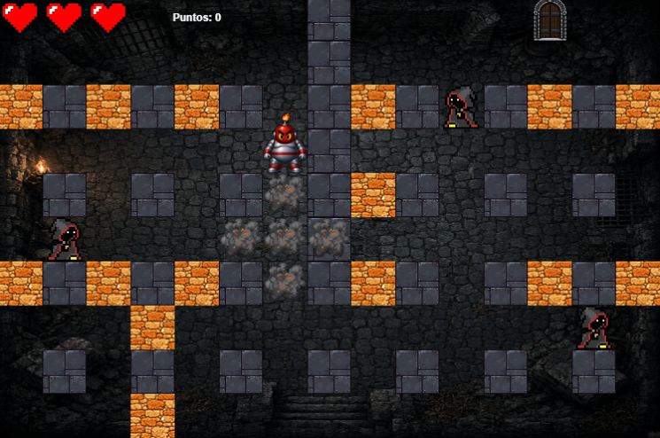

# 💣 BomberBot

**Un juego de laberintos y estrategia inspirado en Bomberman, hecho en Wollok Game.**

Grupo **Herencia de Problemas**

---

## 👥 Integrantes

- Benjamín Caiazzo
- Thiago Calascibetta
- Santiago Tolosa
- Matias Fasce
- Israel Poveda

---

## 🎮 Cómo jugar

### Objetivo

En BomberBot, tu meta es superar cada nivel del laberinto llegando hasta la puerta de salida. Para lograrlo, deberás abrirte camino colocando **bombas** para destruir muros y eliminar a tus enemigos. Pero ten cuidado: **si una explosión te alcanza, pierdes la partida**.

En algunos niveles la puerta estará bloqueada y solo se abrirá al cumplir una condición, que varía según el nivel (por ejemplo, eliminar a todos los enemigos).

Por suerte, a lo largo de la aventura encontrarás **Power-Ups** que mejorarán tus habilidades y harán la travesía más amena.

### Controles

| Tecla | Acción |
|:---:|---|
| <kbd>←</kbd> <kbd>→</kbd> <kbd>↑</kbd> <kbd>↓</kbd> | Mover personaje |
| <kbd>W</kbd> <kbd>A</kbd> <kbd>S</kbd> <kbd>D</kbd> | Mover personaje |
| <kbd>Q</kbd> | Poner una bomba |
| <kbd>R</kbd> | Reiniciar el juego desde el nivel 1 |

---

## 🗺️ Niveles

| Nivel | Enemigos | Descripción |
|:---:|---|---|
| **1** | 3 Patrulleros | Introduce las bombas y los muros. Hay una llave escondida que te abrirá la puerta hacia el siguiente nivel. |
| **2** | 1 patrullero y 1 fantasma | Introduce un nuevo enemigo, el fantasma. Para ganar debes **eliminar a todos los enemigos**. |

---

## 👾 Enemigos

| Enemigo | Comportamiento |
|---|---|
| **Patrullero vertical** | Se mueve de arriba hacia abajo y viceversa. |
| **Patrullero horizontal** | Se mueve de izquierda a derecha y viceversa. |
| **Fantasma** 👻 | Te persigue siempre y **traspasa los objetos**. |

---

## ⚡ Power-Ups

| Power-Up | Efecto |
|---|---|
| 💣 **Más bombas** | Permite poner más bombas antes de recargar. |
| ✖️ **Multiplicador de puntaje** | Duplica el puntaje que obtienes. |
| 🛡️ **Escudo** | Bloquea **un solo golpe** de un enemigo. |

---

## 📚 Explicaciones teóricas

Las explicaciones teóricas y los diagramas se encuentran en [explicaciones.md](explicaciones.md).

---

## 📌 Consignas de la cátedra

> Esta sección corresponde a las indicaciones de la materia.

Todo lo que necesitan saber está explicado en [este documento](https://docs.google.com/document/d/1KoB12RIZk_xPhmnOJ-EfLIPNwkETD_EaYMp2srDu9QY/edit?tab=t.0#heading=h.wnm2lu4cls8j). Para todo lo demás, aseguren prestar atención a los comunicados por Discord.

Recuerden que para cada checkpoint hay [expectativas mínimas](https://docs.google.com/document/d/1KoB12RIZk_xPhmnOJ-EfLIPNwkETD_EaYMp2srDu9QY/edit?tab=t.0#heading=h.56t0qdv908v3) respecto a los conceptos aplicados. Procuren:

- Validar su idea con el equipo docente que corresponda por su canal de Discord.
- Para cada checkpoint, asegurar que implementaron lo necesario para esa instancia y crear un **tag** en el repositorio para facilitar la comparación entre versiones final e intermedias.
- Para la demo final, crear un nuevo tag **demo** y actualizar este README con todo lo necesario.