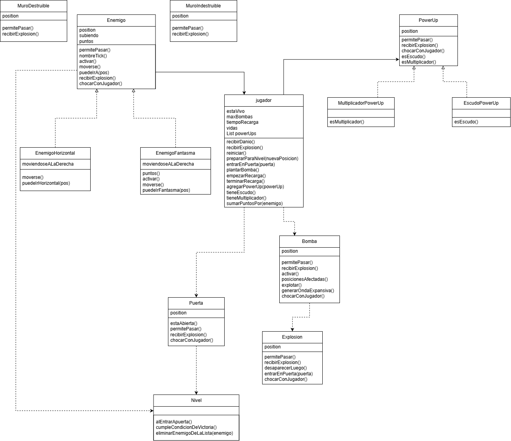

# Explicaciones teóricas

Polimorfismo: Cuando una bomba explota, todos los objetos que se encuentren en el radio de la explosion recibiran la explosion de manera polimorfica, es decir, cada uno entiende el mensaje recibirExplosion de diferente manera sin necesidad de que la bomba pregunte que objeto tiene al lado para saber como afectarlo.

Instancias: Cuando hay una explosion creo una instacia nueva de esta misma por cada celda del mapa afectada.

# Diagramas

*Incluír al menos un diagrama para comunicar su solución*
