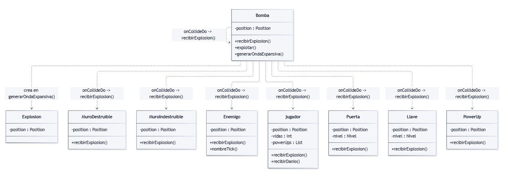
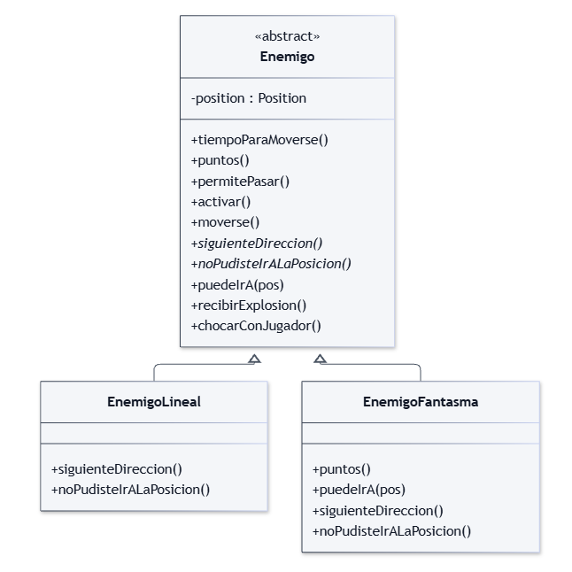
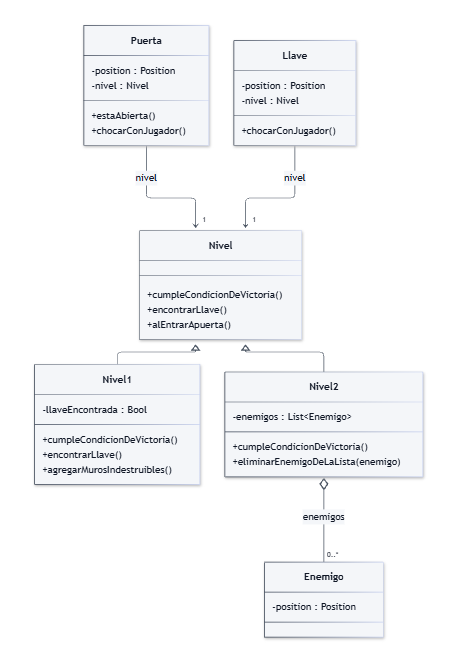

# Explicaciones teóricas

Polimorfismo en recibirExplosion():
Cuando una bomba explota, permite que una explosión interactúe con cualquier entidad del tablero enviándole un único mensaje, sin consultar su clase ni depender de estructuras condicionales por tipo de objeto.

1. Explosion y Bomba desacopladas del tipo de objeto
Cuando una Bomba explota, genera instancias de Explosion en las posiciones afectadas y registra la colisión mediante:
    - game.onCollideDo(explosion, { elemento => elemento.recibirExplosion() }).

Explosion no necesita saber qué objeto ocupa la celda: simplemente le envía recibirExplosion(). Si se agregaran nuevos eleentos al juego, Bomba y Explosion no requieren modificarse siempre que el nuevo objeto entienda recibirExplosion().

2. Comportamiento polimórfico por objeto o clase
Aunque todos responden al mismo mensaje recibirExplosion(), cada uno define su propia reacción:

MuroDestruible: se elimina del tablero (game.removeVisual(self)).

MuroIndestruible, Puerta, Llave y PowerUp: implementan recibirExplosion() {} sin efecto, ya que la explosión no los destruye ni altera su estado directamente.

Enemigo: se da de baja del nivel actual, detiene su evento periódico (removeTickEvent), se quita de pantalla (removeVisual) y le suma puntos al jugador.

Bomba: delega en self.explotar(), provocando una reacción en cadena si otra bomba queda alcanzada por la onda expansiva.

jugador: delega en self.recibirDanio(), donde se evalúa polimórficamente sobre su colección powerUps (bloqueaDanio()) si un escudo absorbe el impacto o si se descuenta una vida.

Polimorfismo entre jugador y PowerUp:
El jugador guarda todos los power-ups que obtiene en una única lista (powerUps) y delega en ellos distintas responsabilidades sin consultar su tipo concreto. La clase base PowerUp define valores neutros por defecto, y las subclases redefinen únicamente lo que les corresponde.

1. Mensajes uniformes sin preguntar el tipo
El jugador interactúa con los elementos de powerUps a través de tres mensajes principales:

bloqueaDanio(): en recibirDanio(), el jugador pregunta powerUps.any{ p => p.bloqueaDanio() } para saber si algún ítem activo absorbe el golpe, y luego powerUps.find{ p => p.bloqueaDanio() } para encontrarlo, quitarlo y evitar perder una vida.

modificarPuntos(puntos): en sumarPuntosPor(enemigo), el jugador acumula puntaje con powerUps.fold(puntosBase, { acumulado, p => p.modificarPuntos(acumulado) }), dejando que cada power-up transforme o no el acumulado (por ejemplo, duplicándolo en el multiplicador).

bombasExtras(): en maxBombas(), el jugador calcula su capacidad total con 3 + self.bombasExtras(), donde bombasExtras() suma p.bombasExtras() sobre toda la lista.

2. Valores neutros en PowerUp y especialización en subclases
PowerUp actúa como base con comportamientos neutros (bloqueaDanio() = false, modificarPuntos(puntos) = puntos, bombasExtras() = 0).

Gracias a esos valores neutros, un power-up de un tipo no necesita implementar ni inventar lógica para los otros aspectos: simplemente hereda el comportamiento neutro en lo que no le aplica y redefine solo lo suyo.

Esto permite combinar varios power-ups a la vez (por ejemplo, tener un escudo, un multiplicador y bombas extra en la misma partida) sin llenar el código del jugador de condicionales por clase.

Herencia con Enemigo
La herencia alrededor de Enemigo permite concentrar en una clase base todo el comportamiento y el estado común a los enemigos del juego, mientras cada subclase define únicamente aquello que cambia según su tipo o comportamiento.

1. Qué concentra la clase Enemigo
En el código base de Enemigo se agrupan las responsabilidades compartidas por todos los enemigos:

Estado y valores base: position, tiempoParaMoverse() (600), puntos() (200) y permitePasar() (true).

Ciclo de movimiento y activación: activar() registra el game.onTick usando nombreTick(), y moverse() ejecuta el desplazamiento delegando la elección de dirección y el movimiento real.

Interacción con el entorno: puedeIrA(pos) y todosLosObjetosPermitenPasarA(pos) verifican si las celdas permiten el paso, chocarConJugador() aplica daño al jugador, y recibirExplosion() maneja la eliminación del enemigo (quitándolo del nivel actual, frenando su tick, borrando su visual y sumando puntos al jugador).

2. Métodos abstractos y especialización en subclases
La clase Enemigo deja puntos de extensión pensados para que las subclases completen o redefinan el comportamiento sin duplicar el esqueleto general:

Métodos que cada tipo de enemigo completa o ajusta: siguienteDireccion() y noPudisteIrALaPosicion() definen cómo elige el próximo paso y qué ocurre cuando no puede avanzar a la posición elegida.

Redefiniciones puntuales: una subclase puede cambiar valores o reglas específicas—como puntos() o tiempoParaMoverse()—o redefinir puedeIrA(pos) si un tipo de enemigo atraviesa ciertos obstáculos (como el enemigo fantasma o la jerarquía mostrada en la presentación).

Subtipos más específicos: también se puede especializar aún más la orientación o el nombre base del sprite (por ejemplo, entre comportamiento lineal/patrullero, fantasma, vertical u horizontal) sin reescribir la lógica de ticks, colisión ni explosión.

Herencia de PowerUp
La herencia en PowerUp se usa para modelar distintos ítems potenciadores a partir de una clase base común, evitando repetir cómo se comportan en el mapa y definiendo valores neutros por defecto para los efectos especiales.

1. Comportamiento común en PowerUp
La clase PowerUp concentra lo que comparten todos los power-ups del juego:

Ubicación y presencia en el juego: tiene position, aniadirAlMapa() (game.addVisual(self)) y permitePasar() = true para que el jugador pueda atravesar la celda y recogerlo.

Interacción con explosiones y colisiones: recibirExplosion() no hace nada (el power-up no se destruye al explotar una bomba cerca) y chocarConJugador() agrega el power-up a jugador.powerUps, muestra su efecto visual (efectoVisual()) y lo quita de pantalla (game.removeVisual(self)).

Valores neutros por defecto: define bloqueaDanio() = false, modificarPuntos(puntos) = puntos y bombasExtras() = 0.

2. Especialización en subclases
Cada subtipo de power-up hereda de PowerUp y redefine únicamente el método vinculado a su efecto, dejando el resto en su valor neutro:   Escudo: redefine bloqueaDanio() = true para que el jugador pueda absorber un daño sin perder una vida (y luego consumirse).

Multiplicador de puntaje: redefine modificarPuntos(puntos) (por ejemplo, devolviendo puntos * 2) para potenciar los puntos ganados al eliminar enemigos.

Más bombas: redefine bombasExtras() (por ejemplo, sumando 1) para ampliar la cantidad máxima de bombas disponibles del jugador.

Composición en jugador
En el código de jugador, la composición se ve principalmente en cómo el jugador compone su estado de potenciadores mediante una colección interna de power-ups (powerUps), en lugar de duplicar atributos o comportamientos sueltos por cada tipo de ítem:

Qué compone a jugador: tiene una lista interna powerUps donde se agregan y quitan las instancias de PowerUp obtenidas durante la partida, junto con su estado propio (position, vidas, bombasLanzadas, recargando).

Cómo colaboran las partes: cuando ocurre un evento como recibir daño (recibirDanio()), sumar puntos (sumarPuntosPor(enemigo)) o calcular la capacidad de bombas (maxBombas() / bombasExtras()), jugador consulta y delega en los elementos contenidos en powerUps.

Por qué es composición: los power-ups forman parte del estado actual del jugador mientras están activos (se suman con agregarPowerUp, se consumen/quitan con removerPowerUp o se limpian con reiniciar()), y el jugador coordina su uso sin tener que saber de qué clase concreta es cada uno.

Composición en Nivel
El rol de Nivel como elemento compuesto/coordinador aparece especialmente en cómo contiene y coordina elementos del mapa y reglas de avance —como Puerta y Llave (a los que se les inyecta nivel), los muros/grilla y la lista de enemigos en el nivel 2:

Qué compone o articula Nivel: cada nivel gestiona su propia configuración de mapa/elementos y su condición de victoria (por ejemplo, en el nivel 1 se abre la puerta al encontrar la llave; en el nivel 2, al eliminar a todos los enemigos de la lista).

Delegación bidireccional clara: Puerta y Llave reciben una referencia a su nivel al crearse y le delegan la lógica de qué significa ganar o abrirse (nivel.encontrarLlave(), nivel.cumpleCondicionDeVictoria(), nivel.alEntrarApuerta()), mientras que Nivel concentra el estado propio de ese nivel (llaveEncontrada, enemigos).

Por qué es composición: evita meter lógica de "qué nivel estoy jugando" dentro de Puerta o Llave; cada nivel encapsula sus reglas y sus elementos asociados, y se puede probar de forma aislada en tests instanciando los objetos con su nivel.

Composición en Explosion
En el código y la presentación, Explosion representa cada celda afectada por la onda expansiva y compone su comportamiento visual/temporal mediante objetos o mecanismos asociados a su ciclo de vida (como su animación de frames y su desaparición programada), creados por Bomba.generarOndaExpansiva():

Qué compone a Explosion: cada instancia se crea en una position específica del rango de la bomba y maneja su representación visual animada (empezarAnimacion(), desaparecerLuego(), y en la diapositiva 15 se muestra la composición con Animacion que lleva frameActual, framesMaximos y avanzar()).

Cómo se integra con Bomba: Bomba.generarOndaExpansiva() recorre posicionesAfectadas(), crea una Explosion por celda, la agrega a game, dispara su animación/desaparición y asocia la colisión para notificar recibirExplosion() a los elementos tocados.

Por qué es composición: delegar el conteo de frames o el ciclo visual a una pieza compuesta (Animacion) separa el manejo de la animación de la lógica propia de la explosión en el tablero.

# Diagramas

*Incluír al menos un diagrama para comunicar su solución*

